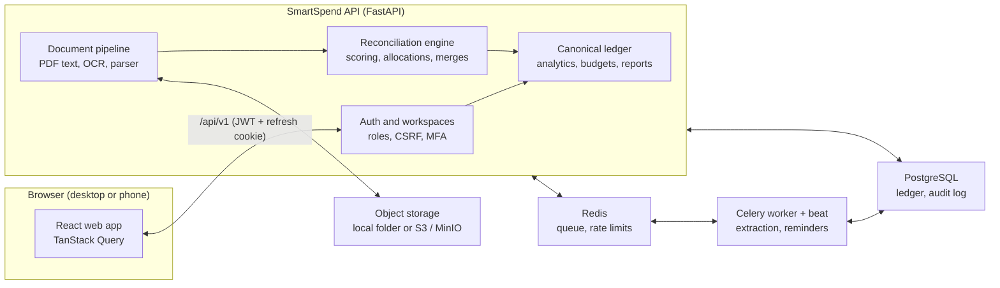

# 💸 SmartSpend

[](https://www.python.org/)
[](#-technology-stack)
[](#-technology-stack)
[](#-technology-stack)
[](#-database-scripts)
[](#-run-the-application)
[](#-build-test-and-deploy)

**Expense management that counts every purchase once.** Upload bills and receipts, import bank, card and UPI statements, and record cash and person-to-person payments. SmartSpend recognises when a bill and a payment (or two copies of the same payment) describe the same real-world purchase, explains why it thinks so, and changes your totals only after you confirm.

SmartSpend never invents values it can't read from a document, never merges records without your confirmation, and every link, merge and unlink can be undone and is audited.

---

## 🏛️ System Architecture



Uploaded documents and imported statement rows become **source records** (evidence). The reconciliation engine links them into **canonical transactions**, the single ledger that dashboards and reports read. A bill and the UPI payment that paid it end up as one purchase, so totals never double count. In development, background jobs run inline and PostgreSQL runs embedded, so neither Redis nor Docker is needed.

## 🌟 Technology Stack

| Layer | Technologies | Responsibility |
|---|---|---|
| Web app | React 19, TypeScript, Vite, Tailwind CSS 4, Radix UI (shadcn-style), TanStack Query, Recharts | Dashboard, review screens, charts, light/dark themes, phone layout with bottom navigation |
| API | Python 3.11, FastAPI, Pydantic 2 | Auth, workspaces and roles, validation, idempotent writes, OpenAPI docs at `/api/docs` |
| Domain | SQLAlchemy 2, `Decimal` money (NUMERIC 19,4) | Reconciliation, allocations, ledger maths, budgets, loans, shared bills, credit card cycles |
| Documents | PyMuPDF, pdfplumber, RapidOCR (or Tesseract), rapidfuzz | Text extraction, OCR with tilt correction, receipt/invoice/UPI parsing, explainable categorisation |
| Reports | ReportLab, openpyxl | PDF, Excel and CSV exports |
| Persistence | PostgreSQL 16, Alembic | Ledger, audit history, migrations; embedded via `pgserver` in development |
| Background jobs | Celery, Redis | Document processing, scheduled checks and reminders |
| Storage | Local folder or S3-compatible (MinIO) | Private document storage behind short-lived signed links |
| Optional AI | Anthropic Claude (off by default) | Suggestions only; values must appear in the document text, and totals never depend on AI |
| Testing | pytest, Vitest, Playwright | Backend scenarios on real PostgreSQL, unit tests, browser end-to-end tests (desktop and phone) |
| Deployment | Docker Compose, nginx, GitHub Actions | Production-like stack and CI |

## 🧩 Key Capabilities

### 1. 🔗 Reconciliation that counts each purchase once

* **Bill ↔ payment matching:** deterministic, weighted scoring of references, amounts, dates and merchant names, with high/medium/low confidence and a plain-language "why these were matched" list.
* **Many-to-many allocations:** partial payments, one payment covering several bills, and overpayment remainders.
* **Duplicates and refunds:** merge duplicate records (kept traceable), and link refunds and reversals to the original purchase.
* **One decision per suggestion:** *Link payment to bill* / *Same transaction — merge* / *Link refund*, or *Not a match — keep separate*. Every decision can be undone and is in the audit history.
* **Safe under concurrency:** row locks, partial unique indexes and idempotency keys prevent races and double allocation.

### 2. 🧾 Bills, receipts and statements

* **Upload a bill** from the *Add transaction* button or the Upload page: PDF, JPG, PNG or WebP, up to 15 MB.
* **Extraction:** merchant, date, time, total, tax, discount, invoice number, UPI reference, payment method and line items, each with a confidence score and validation results. Missing values are left empty, never guessed.
* **Image OCR** works out of the box (RapidOCR). Tilted and curled photos are straightened, and values found that way are flagged "please check".
* **Statement import:** CSV, XLSX and PDF with column mapping, preview and row fingerprints, so importing the same statement twice adds nothing.
* **Duplicate upload protection:** the same file is rejected, with a link to the original.

### 3. 🏷️ Automatic categories with reasons

* An evidence-scoring classifier reads the merchant, description, line items and bill text (for example, a water authority bill is categorised as Water, with the matched words shown).
* Order of precedence: your rules → your past choices for that merchant → keyword evidence → optional AI → Uncategorised.
* Manual choices are never overwritten, and *Re-categorise* only touches automatically categorised transactions.

### 4. 💳 Credit cards, people and planning

* **Credit card bills:** limits, statements (total and minimum due, due date, interest and fees), status (paid, minimum paid, overdue, paid late), utilisation, unbilled spend and due-date reminders. Card purchases count as spending once; paying the bill is a transfer.
* **People and shared expenses:** money lent and borrowed, split bills and who owes what.
* **Budgets, savings goals and recurring expenses,** with alerts when a budget is close to its limit.
* **Analytics and reports:** monthly trends, categories, merchants, payment methods, fixed vs variable spending and item price history, exportable to CSV, Excel and PDF.

### 5. 👥 Workspaces, roles and notifications

* Every account gets its own **workspace** with default categories and a Cash account. Most people only ever need one.
* Share a workspace with a partner, family member or accountant as **Owner**, **Admin**, **Member** (adds and edits) or **Viewer** (read-only). A workspace always keeps at least one owner.
* Create more workspaces to keep, for example, business expenses completely separate; switch between them from the sidebar.
* **Notification bell** next to the logo: budget alerts, upcoming bills, duplicate-payment warnings, failed documents and unmatched receipts.

### 6. 📱 Responsive, accessible interface

* Desktop sidebar; on phones, a bottom navigation bar with a central **+** button, and dialogs that open as bottom sheets.
* Subtle motion (page transitions, staggered cards, count-up totals, growing bars) that switches off automatically when the device asks for reduced motion.
* Keyboard navigation, visible focus, skip link, table views for every chart and a validated colour-blind-safe chart palette.

## 📁 Repository Structure

| Path | Purpose |
|---|---|
| `backend/app/core` | Configuration, database session, security, rate limiting, storage, email |
| `backend/app/models` | SQLAlchemy models (identity, ledger, documents, reconciliation, cards, planning) |
| `backend/app/modules/auth`, `households` | Sign-up, sign-in, sessions, MFA, password reset codes; workspaces and roles |
| `backend/app/modules/ledger`, `reconciliation` | Canonical transactions; matching, allocations, merges, audit |
| `backend/app/modules/documents`, `imports` | Upload pipeline, OCR and parser; statement import |
| `backend/app/modules/categories`, `merchants`, `prices` | Classifier, rules, merchant aliases, item price history |
| `backend/app/modules/cards`, `people`, `planning` | Credit card statements; loans and shared bills; budgets, goals, recurring |
| `backend/app/modules/analytics`, `reports`, `notifications` | Dashboards, exports, alerts |
| `backend/app/modules/privacy`, `integrations`, `ai` | Export and account deletion; integration status; optional AI suggestions |
| `backend/alembic` | Database migrations |
| `backend/tests` | 197 tests on real PostgreSQL |
| `backend/scripts` | `dev.py` (dev launcher with auto-reload), `seed_demo.py`, `make_fixtures.py` |
| `backend/fixtures` | Sample bills, receipts, a UPI screenshot and statements for trying the app |
| `frontend/src/pages`, `components` | React pages and shared components |
| `frontend/e2e` | Playwright end-to-end tests (desktop and phone) |
| `database/` | SQL scripts: create database, full schema, reset, admin reports; backup and restore helpers |
| `docs/` | Architecture, setup, deployment, security and API documentation |
| `docker-compose.yml`, `.env.example`, `.github/workflows/ci.yml` | Deployment stack, configuration template, CI |

## 💻 Prerequisites

* **Python 3.11+** and **Node.js 20+** (22 recommended).
* Windows, macOS or Linux. Docker is **not** needed for development: PostgreSQL 16 runs embedded.
* OCR needs no system install: RapidOCR comes with `requirements.txt`. If Tesseract is installed it is used instead.
* For the production-like stack: **Docker** with Docker Compose.
* Optional: SMTP credentials to send real verification and password-reset emails.

## 🚀 Run the Application

### Local development (no Docker)

```bash
python -m venv .venv
.venv/Scripts/pip install -r backend/requirements-dev.txt      # .venv/bin/pip on macOS/Linux
cd frontend && npm install && cd ..

# Terminal 1: API on http://127.0.0.1:8000 (starts PostgreSQL and applies migrations)
cd backend && ../.venv/Scripts/python scripts/dev.py

# Terminal 2: web app on http://127.0.0.1:5173 (proxies /api to :8000)
cd frontend && npm run dev
```

Open http://localhost:5173 and create an account. Email verification is off in local development. The API restarts by itself when a file under `backend/app/` changes. New migrations are not applied automatically; run `python -m alembic upgrade head` in `backend/` when they're ready.

### Demo data

Start the API with `DEMO_MODE=true` and sign in as `demo@example.com` / `DemoPassw0rd!`. The demo workspace is clearly labelled as sample data.

### Docker Compose (production-like)

```bash
cp .env.example .env          # set SECRET_KEY, ENCRYPTION_KEY, POSTGRES_PASSWORD, MINIO_ROOT_PASSWORD
docker compose up --build     # http://localhost:8080
```

This runs PostgreSQL, Redis, MinIO (a private document bucket), the API, a Celery worker and beat, and nginx serving the web app. Add `--profile scan` and `MALWARE_SCANNER=clamav` to scan uploads with ClamAV.

### Sending real email

Without SMTP, emails are written to the API log, and in development the *Forgot password* page shows the reset code on screen. To deliver real emails, put your provider's settings in `backend/.env` and restart the API. For Gmail, use an [app password](https://myaccount.google.com/apppasswords):

```ini
SMTP_HOST=smtp.gmail.com
SMTP_PORT=587
SMTP_USER=you@gmail.com
SMTP_PASSWORD=your16charapppassword
SMTP_FROM=SmartSpend <you@gmail.com>
```

## 🖥️ Using SmartSpend

1. **Create an account.** You get your own workspace (named after you; rename it any time in Settings).
2. **Add transactions** with **Add transaction** (or the **+** button on a phone): *Upload a bill* to have it read for you, or *Enter manually* for cash, UPI and card spending without a bill.
3. **Review uploaded bills.** Check the extracted values and suggested category (with its reasons), correct anything, then **Confirm & save**.
4. **Import statements** from Upload → Statements. Rows that duplicate earlier imports are skipped.
5. **Resolve matches** in **Duplicates & Reconciliation**: link a payment to its bill, merge a duplicate, link a refund, or mark the pair *Not a match — keep separate*.
6. **Plan and track** with budgets, recurring expenses, credit card bills and people. Alerts appear under the bell.
7. **Report** from Analytics & Reports, and export to CSV, Excel or PDF.

Totals are the same however a purchase was recorded: a bill and its matching payment count once.

## 🔒 Security and Privacy

* **Passwords** are hashed with Argon2id and can't be read back by anyone. Five failed sign-ins lock an account for 15 minutes.
* **Sessions:** a 15-minute access token kept in memory, and a rotating refresh token in an httpOnly cookie with double-submit CSRF protection. A password reset signs out every session.
* **Password reset:** a 6-digit emailed code (valid 15 minutes, 5 attempts, newest code only) or a one-hour link. Responses never reveal whether an email is registered.
* **Optional TOTP MFA,** with secrets encrypted at rest.
* **Workspace isolation:** every query is scoped to a workspace the caller belongs to, checked on the server for every request.
* **Documents** are stored privately and served only through short-lived signed links. Uploads are type- and size-checked, with optional ClamAV scanning.
* **Never stored:** UPI PINs, banking passwords or card security codes.
* **AI is off by default.** When an administrator configures it and a workspace opts in, bill text may be sent for suggestions only.
* **Rate limiting** on authentication endpoints and an audit log of financial decisions.

See [docs/SECURITY.md](docs/SECURITY.md) for the threat model, controls and data retention.

## 🗄️ Database Scripts

The [`database/`](database/README.md) folder has plain SQL for running SmartSpend on a PostgreSQL server you manage:

| Script | Purpose |
|---|---|
| `database/00_create_database.sql` | Create the `smartspend` role and database (`psql -U postgres -v app_password=... -f ...`) |
| `database/01_schema.sql` | Complete schema (37 tables), generated from the migrations |
| `database/02_reset_data.sql` | Delete all data but keep the schema (dev/test only; needs `-v confirm=yes`) |
| `database/03_reports.sql` | Read-only admin queries: workspaces, monthly spending, matches to review, card bills due |
| `database/scripts/db.ps1`, `db.sh` | `schema` (regenerate), `backup` (pg_dump) and `restore` (pg_restore, with confirmation) |

## 🧪 Build, Test, and Deploy

| Task | Command |
|---|---|
| Backend tests (197, real PostgreSQL) | `cd backend && ../.venv/Scripts/python -m pytest` |
| Frontend unit tests | `cd frontend && npx vitest run` |
| Type check | `cd frontend && npx tsc -b` |
| Browser end-to-end tests (12, desktop and phone) | `cd frontend && npx playwright install chromium && npx playwright test` (both dev servers running) |
| Production web build | `cd frontend && npm run build` |
| Apply database migrations | `cd backend && ../.venv/Scripts/python -m alembic upgrade head` |
| Regenerate the SQL schema script | `.\database\scripts\db.ps1 schema` or `database/scripts/db.sh schema` |
| Back up the database | `.\database\scripts\db.ps1 backup` (uses `DATABASE_URL`) |
| Production-like stack | `docker compose up --build` |

The backend suite covers specification Scenarios A–J, concurrency (parallel confirms and over-allocation races), duplicate statement imports, authentication and data isolation, password-reset codes, upload security, OCR and categorisation, credit card cycles, monetary precision, month-end boundaries, reports, and an end-to-end journey in which the computed account balance must equal the bank statement's closing balance. CI runs on pushes to `main` and on pull requests (`.github/workflows/ci.yml`).

## 📦 Data Locations

| Location | Contents | Notes |
|---|---|---|
| `backend/var/pgdata/` | Embedded PostgreSQL data (development) | Delete to start fresh; this erases local data |
| `backend/var/storage/` | Uploaded documents (development, `STORAGE_BACKEND=local`) | Production uses a private S3/MinIO bucket |
| `backend/var/backend.log`, `frontend.log` | Dev server logs | Written when started with output redirected |
| `database/backups/` | `pg_dump` backups from `db.ps1 backup` | Ignored by git |
| `backend/.env` or `.env` | Local configuration and secrets | Never commit; see `.env.example` |
| Browser local storage | Theme, selected workspace, dismissed tips | Per browser; no financial data |

## 🩺 Troubleshooting

| Symptom | What to check |
|---|---|
| Password-reset email never arrives | SMTP isn't configured. Set `SMTP_*` in `backend/.env` (Gmail needs an app password) and restart the API. In development the code is shown on the reset page. |
| Photos stay in *Needs review* with an OCR message | Run `pip install -r backend/requirements.txt` (installs RapidOCR), then **Re-run extraction** on the document. |
| A bill gets the wrong category | Open it, pick the right category, and add a rule in **Categories & Rules** so future bills from that merchant follow it. |
| "Account temporarily locked" at sign-in | Five failed attempts lock the account for 15 minutes, or use **Forgot password**. |
| "Too many requests" during sign-in or tests | Auth endpoints allow 10 requests per minute per IP (120 under `dev.py`). Set `RATE_LIMIT_AUTH_PER_MINUTE` if needed. |
| Port 8000 is busy | Another API instance is running. Stop it, or set `PORT=8001` (and `VITE_API_PROXY`). |
| Embedded PostgreSQL won't start | Delete `backend/var/pgdata` (erases local data) or point `DATABASE_URL` at your own PostgreSQL 16. |
| Schema changes don't appear | `dev.py` doesn't auto-apply new migrations; run `python -m alembic upgrade head` in `backend/`. |

## 📚 Documentation

* [Architecture](docs/ARCHITECTURE.md): system design, ER diagram, source vs canonical records, the matching algorithm, calculation rules and API contracts.
* [Setup](docs/SETUP.md): development setup, configuration reference, sample fixtures and troubleshooting.
* [Deployment](docs/DEPLOYMENT.md): production deployment, HTTPS, backups and restore, upgrades and monitoring.
* [Security](docs/SECURITY.md): threat model, controls, privacy, AI data handling and retention.
* [API](docs/API.md): API conventions and examples; interactive docs at `/api/docs`.
* [Database scripts](database/README.md): create, schema, reset, reports, backup and restore.
