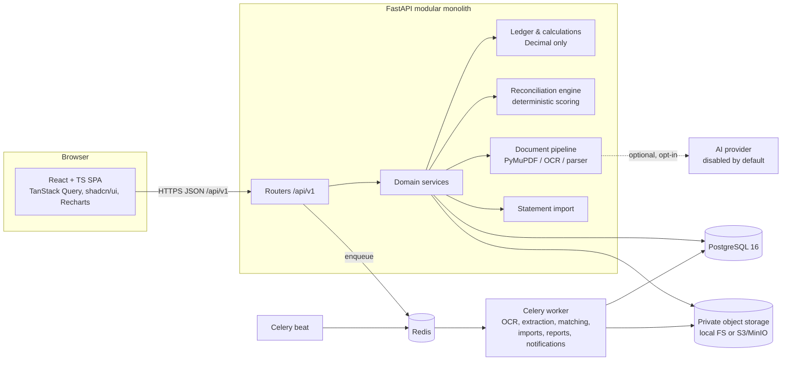

# SmartSpend — Architecture & Design

This document is the design of record. It covers the system architecture, the data model,
the reconciliation model that prevents double counting, the matching algorithm, the financial
calculation rules, the API contracts, the folder structure, and the phased plan.

---

## 1. System architecture



* **Modular monolith.** One deployable FastAPI app; each domain lives in `app/modules/<name>/`
  with its own `router.py`, `schemas.py` and `service.py`. Modules talk through service functions,
  never through each other's routers. Models are shared in `app/models/`.
* **Background work.** OCR, extraction, statement parsing, candidate generation, report rendering
  and notification checks run as Celery tasks. Every job is recorded in the database
  (`document_processing_jobs`) and is idempotent: a task locks its job row, checks its state and
  exits if the work is already done. Retries are bounded (`max_retries=3`, exponential backoff).
  In development and tests `CELERY_TASK_ALWAYS_EAGER=true` runs tasks inline, so no Redis is
  needed.
* **Storage.** Uploaded files are stored under random keys in a private bucket or directory. The
  storage directory is never web-served. Downloads go through
  `GET /api/v1/documents/{id}/download-link`, which returns a short-lived (5 minute) HMAC-signed URL
  bound to the document and household.
* **AI is optional.** All extraction, categorisation, matching and totals are deterministic. When enabled (see
  SECURITY.md), AI only fills *empty* review fields, and only with values found in the document text, or
  categorises a transaction no rule matched (priority step 5).
  An AI provider can be configured for suggestions only. It is off by default and requires
  `AI_ALLOW_DOCUMENT_SHARING=true` plus a household-level opt-in. AI output never merges records on
  its own.

## 2. Entity-relationship diagram

```mermaid
erDiagram
  USERS ||--o{ HOUSEHOLD_MEMBERS : joins
  HOUSEHOLDS ||--o{ HOUSEHOLD_MEMBERS : has
  USERS ||--o{ USER_SESSIONS : has
  HOUSEHOLDS ||--o{ ACCOUNTS : owns
  HOUSEHOLDS ||--o{ CATEGORIES : owns
  CATEGORIES ||--o{ CATEGORIES : parent
  HOUSEHOLDS ||--o{ MERCHANTS : owns
  MERCHANTS ||--o{ MERCHANT_ALIASES : known_as
  HOUSEHOLDS ||--o{ COUNTERPARTIES : owns
  HOUSEHOLDS ||--o{ USER_RULES : owns

  HOUSEHOLDS ||--o{ DOCUMENTS : owns
  DOCUMENTS ||--o{ DOCUMENT_PROCESSING_JOBS : processed_by
  DOCUMENTS ||--o| EXTRACTED_DOCUMENTS : yields
  HOUSEHOLDS ||--o{ STATEMENT_IMPORTS : owns
  STATEMENT_IMPORTS ||--o{ STATEMENT_ROWS : contains

  CANONICAL_TRANSACTIONS ||--o{ SOURCE_RECORDS : "evidenced by"
  DOCUMENTS ||--o{ SOURCE_RECORDS : "origin of"
  STATEMENT_ROWS ||--o| SOURCE_RECORDS : "origin of"
  CANONICAL_TRANSACTIONS ||--o{ TRANSACTION_LINE_ITEMS : has
  CANONICAL_TRANSACTIONS }o--|| CATEGORIES : categorised
  CANONICAL_TRANSACTIONS }o--o| MERCHANTS : at
  CANONICAL_TRANSACTIONS }o--o| COUNTERPARTIES : with
  CANONICAL_TRANSACTIONS }o--o| ACCOUNTS : from_to
  CANONICAL_TRANSACTIONS }o--o| CANONICAL_TRANSACTIONS : "related (refund/reversal/merged)"

  SOURCE_RECORDS ||--o{ RECONCILIATION_MATCHES : left_or_right
  RECONCILIATION_MATCHES ||--o{ RECONCILIATION_ALLOCATIONS : creates
  SOURCE_RECORDS ||--o{ RECONCILIATION_ALLOCATIONS : "payment / bill"
  RECONCILIATION_MATCHES ||--o{ RECONCILIATION_AUDIT_LOGS : history
  HOUSEHOLDS ||--o{ DUPLICATE_CANDIDATES : flags

  COUNTERPARTIES ||--o{ LOANS : party
  LOANS ||--o{ LOAN_REPAYMENTS : repaid_by
  CANONICAL_TRANSACTIONS ||--o| SHARED_EXPENSES : split_as
  SHARED_EXPENSES ||--o{ SHARED_EXPENSE_PARTICIPANTS : among
  HOUSEHOLDS ||--o{ BUDGETS : sets
  HOUSEHOLDS ||--o{ SAVINGS_GOALS : sets
  HOUSEHOLDS ||--o{ RECURRING_EXPENSES : tracks
  HOUSEHOLDS ||--o{ NOTIFICATIONS : receives
  HOUSEHOLDS ||--o{ AUDIT_LOGS : records
```



Key constraints (all enforced in PostgreSQL, see `alembic/versions`):

| Table | Constraint | Purpose |
|---|---|---|
| `documents` | `UNIQUE(household_id, sha256)` | an exact duplicate file is never stored twice |
| `statement_rows` | `UNIQUE(household_id, fingerprint)` | re-importing a statement cannot duplicate rows |
| `source_records` | `UNIQUE(statement_row_id)`, `UNIQUE(document_id)` (partial, where not null) | one source record per origin, even under concurrent processing |
| `reconciliation_matches` | `UNIQUE(household_id, left_source_id, right_source_id, kind)`, `CHECK(left < right)` | one candidate per unordered pair |
| `reconciliation_allocations` | partial `UNIQUE(payment_source_id, bill_source_id) WHERE status='active'`, `CHECK(amount > 0)` | no duplicate allocations |
| `idempotency_keys` | `UNIQUE(household_id, key)` | replayed POSTs return the first result |
| `merchant_aliases` | `UNIQUE(household_id, normalized_alias)` | one alias resolves to one merchant |
| `categories` | `UNIQUE(household_id, parent_id, name)` | no sibling duplicates |
| money columns | `NUMERIC(19,4)` + `CHECK(amount >= 0)` | exact decimals; direction is carried by type, not sign |

Deletion behaviour: household deletion cascades to all household data. Deleting a document is
blocked while a confirmed source record references it; the document is archived instead.
Canonical transactions are never hard-deleted once confirmed. They are voided, and the audit log
keeps the history.

## 3. Source records, canonical transactions and allocations

This is the core of double-counting prevention.

| Concept | What it is | Example |
|---|---|---|
| **Source record** | One piece of evidence, as it was received. Immutable apart from linking. Its role is `bill` (evidence of a purchase or obligation) or `payment` (evidence of money moving). | a receipt PDF, one CSV statement row, a UPI screenshot, a manually typed cash entry |
| **Canonical transaction** | The real-world financial event in the ledger. Totals are computed only from these. | "Dinner at ABC Restaurant, ₹450, 18 Oct" |
| **Allocation** | "₹X of payment P settles bill B". Many-to-many between payment and bill source records. | ₹900 of UPI #123 → invoice A, ₹600 → invoice B |

Lifecycle:

1. Each new source record creates (or attaches to) exactly one canonical transaction, so every
   legitimate expense is visible and counted, even with no receipt (Scenario I).
2. The matching engine writes **suggestions** (`reconciliation_matches`, status `suggested`).
   Suggestions never change totals.
3. When the user confirms a match:
   * **bill ↔ payment** → an allocation is created. A bill's canonical transaction counts its full
     amount. A payment's canonical transaction counts only its **unallocated remainder**:
     `effective_amount = amount − allocated_out`. A receipt and its UPI payment therefore count
     once (Scenario A). A ₹510 payment for a ₹500 bill leaves ₹10 counted, labelled as an
     unexplained difference or tip (Scenario G).
   * **duplicate** (same role, the same event seen twice, e.g. a manual UPI entry plus the
     statement row) → the secondary canonical transaction is marked `merged`, with
     `merged_into_id` pointing at the primary. Its source record is re-pointed to the primary.
     Merged canonicals have `effective_amount = 0`.
   * **refund** → the refund canonical transaction gets `related_transaction_id` set to the
     original.
4. **Unlink / reject / reopen** reverses each step exactly: allocations become `removed`, merged
   canonicals are restored, and `effective_amount` is recomputed. Every change is written to
   `reconciliation_audit_logs` with actor, timestamp, before and after.

A second stored figure, `cash_amount`, is the money that actually moved, and it drives account balances and cash
flow. A payment carries its full amount. A bill with no linked payments is assumed to be paid directly, so it
carries its full amount. Once payments are linked to a bill, the bill's `cash_amount` is 0, because the linked
payments carry the cash. That way a receipt and its bank debit never debit the account twice.

`effective_amount` is stored in the database for fast aggregation. It is recomputed inside the same
database transaction as every allocation or merge change, and it can be rebuilt from scratch with
`POST /reconciliation/recalculate`. Tests assert that the stored and recomputed values agree.

Concurrency: confirm, allocate and unlink lock the affected source records with
`SELECT … FOR UPDATE`, in ascending id order to avoid deadlocks. They then re-read allocation sums,
validate, write, and commit. The partial unique index rejects a duplicate allocation even if two
requests race past the application check. Mutating endpoints accept an `Idempotency-Key` header.

## 4. UPI / bill matching algorithm

Candidates are generated when a source record is created and on `POST /reconciliation/recalculate`.
For a source record S, the engine considers other active source records in the same household
whose date is within the window (default ±3 days) **or** that share an exact reference.

**Hard filters (no candidate at all):** different currency; incompatible direction (a bill pairs
only with an outgoing payment); both records carry UPI/UTR references and the references differ
(they are provably different payments); same-role duplicates whose dates differ by more than one
day and that share no reference (Scenario H).

**Scoring (default weights, in `app/modules/reconciliation/config.py`, overridable per household):**

| Stage | Signal | Points |
|---|---|---|
| 1 Exact identifiers | same UPI txn id / UTR / bank reference | +50 |
| | same invoice / receipt number (bill↔bill) | +45 |
| | same order id | +15 |
| 2 Normalised | amount equal | +35 |
| | amount within tolerance (≤ max(₹20, 5%)), payment ≥ bill | +15, with difference explained |
| | amount differs beyond tolerance but a shared reference exists | 0, plus **conflict** flag → Needs Review |
| | same merchant id or a user-confirmed alias | +25 |
| | normalised merchant similarity ≥ 0.90 / ≥ 0.75 | +20 / +10 |
| | same day / ±1 day / within window | +20 / +10 / 0 |
| | times within 2 hours (when both known) | +5 |
| 3 Contextual | line items overlap ≥ 80 % (bill↔bill) | +10 |
| | counterpart already fully allocated or matched elsewhere | −30, with reason |

Score is clamped to 0–100. **High ≥ 75**: prominent suggestion. **Medium 55–74**: needs review.
**Low 35–54**: kept separate and listed in the review queue only. **< 35**: discarded.
Similar names alone can never reach Medium: name similarity is at most 25 points.

Merchant normalisation: lower-case, strip punctuation and legal suffixes (pvt, ltd, llp, inc),
drop generic business words (supermarket, restaurant, store, mart *as a separate word*, …) and
known city names, then compare both the token set and the compacted string with RapidFuzz.
`"Fresh Mart Supermarket"` → `freshmart`; `"FRESHMART TRIVANDRUM"` → `freshmart`. Original values
are always kept.

Every candidate stores machine-readable `reasons` such as `{"code": "amount_equal", "text": "Amounts match exactly (₹450.00)"}`. The UI renders them as the explanation.

### Credit card bills

A card is an account of type `credit_card` with an optional `credit_limit`, `statement_day` and `due_day`.

- **Purchases** made with the card are ordinary expenses on that account. They count as spending on the day
  they happen.
- **A bill** (`credit_card_statements`) records what the bank says is owed for one cycle: `total_due`,
  `minimum_due`, `due_date`, and any `interest_charged` / `fees_charged`. Interest and fees can optionally be
  recorded as expenses. They're the only bill amounts that count as spending.
- **Paying a bill** creates (or links) a `credit_card_payment` transaction from a bank account to the card. It is
  internal: it reduces what is owed, never adds spending. `credit_card_bill_payments` links payments to bills
  many-to-one with partial amounts, so a payment can't be linked beyond its own amount, and an overpayment's
  remainder can settle the next bill.
- **Status** is derived, never stored: `paid` (paid ≥ total), `minimum_paid`, `partially_paid`, `unpaid`, or
  `overdue` (past the due date with less than the minimum paid). There are also `paid_late` and
  `interest_may_apply` flags.
- **Position:** outstanding = −(opening balance + card movements); available = limit − outstanding;
  unbilled = card spending since the last statement date. The statement preview computes the cycle's total
  from recorded transactions as a cross-check against the bank's figures; the bank's figures stay authoritative.
- When the same bill payment is imported from both the bank statement and the card statement, the
  reconciliation engine suggests them as a duplicate. Merging keeps one payment (with both sides of the
  transfer), so the card is credited once.

### Categorisation

The priority order is: (1) your rules → (2) categories you previously chose or confirmed for the same merchant
(majority of those choices, so mixed merchants like marketplaces aren't forced into one category) →
(3) evidence scoring → (4) optional AI → (5) "Other and Uncategorized".

Evidence scoring (`app/modules/categories/classifier.py`) weighs every signal instead of stopping at the first
keyword:

| Where a term is found | Weight |
|---|---|
| merchant name | ×3 |
| description / bank narration | ×2 |
| each line item | ×1 (item vocabulary such as rice or paracetamol applies here only) |
| full text of an uploaded bill | ×1 (utility bills describe themselves in the body: "Water Charge", "kWh") |

- Terms are strong (3), medium (2) or weak (1). Within one field, the 2nd and 3rd distinct terms add ×0.5
  and ×0.25. Distinctive terms also match inside run-together OCR text ("KERALAWATER").
- Misleading phrases ("meter rent", "fuel surcharge", "mineral water") are joined into single tokens before
  scoring, so they don't count as rent, petrol or a water bill.
- A main category wins only with a score ≥ 3 that is at least 30% ahead of the runner-up. A subcategory is
  chosen only with its own evidence. Otherwise nothing is guessed.
- Categories the household creates take part through their names.
- Every automatic choice stores its reasons, which the UI shows (e.g. *bill text: 'water charge'*).
- `POST /transactions/recategorize` re-applies the current logic to automatically categorised transactions
  only.

## 5. Financial calculation rules

All amounts are `Decimal`, quantised to the currency's minor unit with ROUND_HALF_EVEN. Amounts
are stored non-negative, and direction comes from the transaction type. A period is bucketed by
`occurred_on`, a calendar date in the household's timezone. Totals are reported per currency;
nothing is converted with invented FX rates.

| Metric | Formula (over active, non-merged canonical transactions in the period) |
|---|---|
| Gross spending | Σ `effective_amount` where type ∈ {expense} |
| Refunds | Σ amount where type = refund |
| **Net spending** | Gross spending − Refunds |
| Others' share of shared bills you paid | Σ participant shares (not self) of shared expenses you paid |
| Personal spending | Net spending − Others' share |
| Income | Σ amount where type = income |
| Reimbursements in / out | Σ type = reimbursement, by direction (settlements, never spending) |
| Loans given / received, repayments | separate cash-movement lines; never spending. Only interest (type expense, category *Loan Interest*) is spending |
| Transfers, credit card bill payments | excluded from spending and income; shown as cash movements |
| Net cash flow | (Income + Refunds + Reimb. in + Loans received + Repayments received) − (Net-of-refund spending outflow + Reimb. out + Loans given + Repayments made) |
| Reversed / voided / merged | excluded everywhere (merged have effective 0) |
| Remaining budget | budget − net spending (purchases − refunds) in the category subtree for the current period |
| Predicted recurring | shown as *upcoming*; never added to totals until confirmed |

Bill settlement state comes from allocations: `paid = Σ active allocations to bill`;
Unmatched (0), Partially Paid (0 < paid < total), Fully Paid (paid = total).
For a payment: Unmatched, Partially Reconciled or Matched, by allocated share.

## 6. API contracts (summary)

All endpoints are under `/api/v1`, JSON, and authenticated with `Authorization: Bearer <access>`.
The household is selected with `X-Household-ID` (defaults to the user's first household).
List endpoints accept `page` and `page_size` (≤ 200) and return
`{items, total, page, page_size}`. Errors use one envelope:

```json
{"error": {"code": "allocation_exceeds_payment", "message": "…", "details": {…}, "request_id": "…"}}
```

| Area | Endpoints |
|---|---|
| Auth | `POST /auth/register`, `/auth/login`, `/auth/mfa/verify`, `/auth/refresh`, `/auth/logout`, `/auth/verify-email`, `/auth/resend-verification`, `/auth/forgot-password`, `/auth/reset-password`; `GET /auth/sessions`, `DELETE /auth/sessions/{id}`; `POST /auth/mfa/setup`, `/auth/mfa/enable`, `/auth/mfa/disable` |
| Me / privacy | `GET/PATCH /me`, `GET /me/export`, `DELETE /me` |
| Households | `GET/POST /households`, `GET/PATCH /households/{id}`, `GET/POST /households/{id}/members`, `PATCH/DELETE /households/{id}/members/{user_id}` |
| Accounts | CRUD `/accounts`, `GET /accounts/{id}/balance` |
| Categories & rules | CRUD `/categories`, CRUD `/rules`, `POST /rules/test` |
| Merchants | `GET/POST /merchants`, `POST /merchants/{id}/aliases`, `DELETE /merchant-aliases/{id}` |
| Transactions | `GET /transactions` (filters), `POST /transactions`, `GET/PATCH /transactions/{id}`, `POST /transactions/{id}/void`, `GET /transactions/{id}/audit` |
| Documents | `POST /documents` (multipart), `GET /documents`, `GET /documents/{id}`, `GET /documents/{id}/download-link`, `GET /files/{token}`, `POST /documents/{id}/reprocess`, `PUT /documents/{id}/extraction`, `POST /documents/{id}/confirm`, `POST /documents/{id}/archive` |
| Imports | `POST /imports` (upload), `GET /imports/{id}/preview`, `PUT /imports/{id}/mapping`, `POST /imports/{id}/confirm`, `GET /imports` |
| Reconciliation | `GET /reconciliation/candidates`, `GET /reconciliation/{id}`, `POST /reconciliation/{id}/confirm`, `POST /reconciliation/{id}/reject`, `POST /reconciliation/{id}/reopen`, `POST /reconciliation/manual-match`, `POST /reconciliation/allocate-payment`, `POST /reconciliation/unlink`, `POST /reconciliation/recalculate`, `GET /reconciliation/summary`, `GET /reconciliation/queues`, `POST /reconciliation/bulk-confirm` |
| People | CRUD `/counterparties`, `GET /counterparties/{id}/ledger`, CRUD `/loans`, `POST /loans/{id}/repayments`, CRUD `/shared-expenses`, `POST /shared-expenses/{id}/settle` |
| Credit cards | `GET /credit-cards`, `GET /credit-cards/{account_id}`, `GET /credit-cards/{account_id}/statement-preview`, `POST /credit-cards/{account_id}/statements`, `GET/PATCH/DELETE /credit-card-statements/{id}`, `POST /credit-card-statements/{id}/pay`, `/link`, `/unlink` |
| Budgets | CRUD `/budgets`, `GET /budgets/status`, CRUD `/savings-goals` |
| Recurring | CRUD `/recurring`, `POST /recurring/detect`, `POST /recurring/{id}/mark-paid`, `GET /recurring/upcoming` |
| Analytics | `GET /dashboard/summary`, `GET /analytics/{trend,categories,daily,merchants,payment-methods,fixed-variable,budget-vs-actual,income-vs-expense}`, `GET /prices/search`, `GET /prices/history` |
| Reports | `GET /reports/{kind}` with `format=json|csv|xlsx|pdf` |
| Notifications | `GET /notifications`, `POST /notifications/{id}/read`, `POST /notifications/read-all`, `POST /notifications/run-checks` |

The interactive OpenAPI docs are served at `/api/docs`.

## 7. Folder structure

```
backend/
  app/
    core/        config, db, security, money, errors, deps, storage, idempotency, rate limit, celery
    models/      SQLAlchemy models grouped by domain
    modules/
      auth/ households/ accounts/ categories/ merchants/ ledger/ documents/
      imports/ reconciliation/ people/ budgets/ recurring/ analytics/ reports/
      notifications/ audit/ prices/ integrations/ demo/
    main.py worker.py
  alembic/       migrations
  tests/         unit + integration (real PostgreSQL) + API end-to-end
  fixtures/      sample receipts, UPI screenshots, statements
frontend/
  src/ components/ui (shadcn), features/<area>/, lib/, pages/
docs/            ARCHITECTURE, SETUP, DEPLOYMENT, SECURITY
docker-compose.yml, .github/workflows/ci.yml, .env.example
```

## 8. Phased plan

| Phase | Scope | Exit criteria |
|---|---|---|
| 1 Foundation | auth, households, roles, accounts, categories, manual ledger, basic dashboard | data isolation, decimal, and ledger tests pass |
| 2 Document intelligence | upload, hashing, PDF text, OCR, parser, validation, review and confirm, categorisation | extraction fixture tests pass; no fabricated fields |
| 3 Reconciliation | source and canonical model, matching engine, allocations, statement imports, duplicate review UI | Scenarios A–J tests pass; concurrency test passes |
| 4 Financial mgmt | people, loans, shared expenses, budgets, goals, recurring, notifications | settlement and budget tests pass |
| 5 Analytics & hardening | reports and exports, price history, AI hooks, CI, Docker, docs | report tests pass; CI green |
